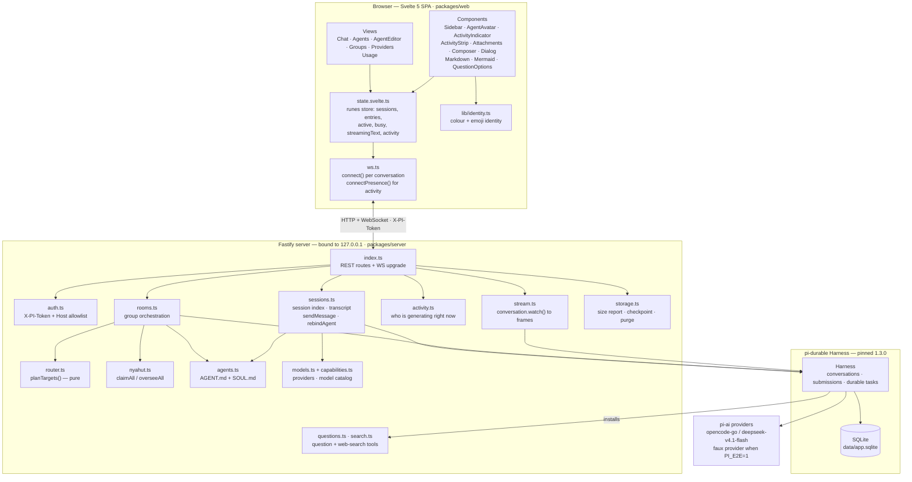
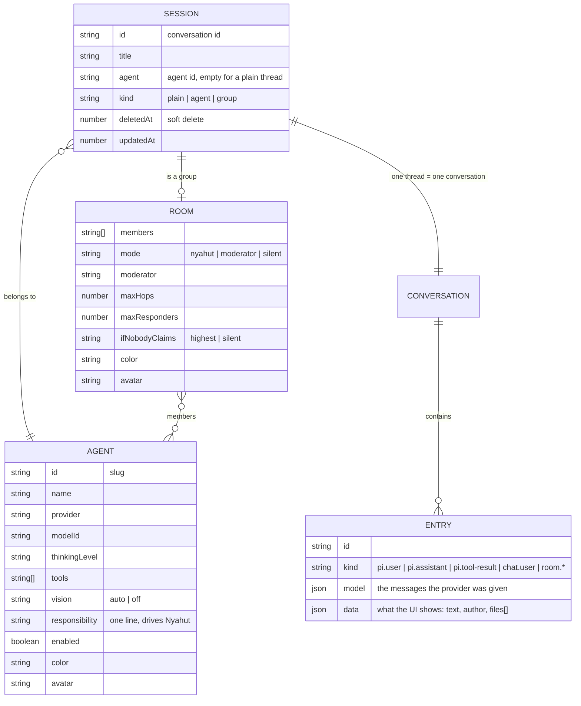
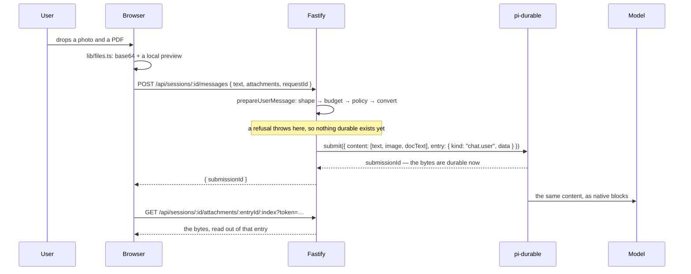
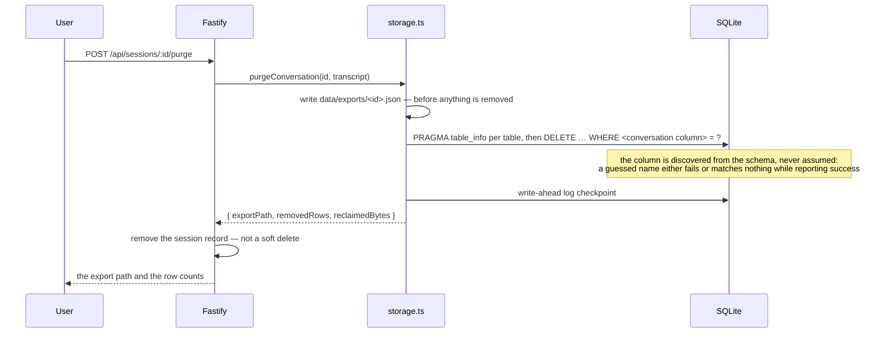
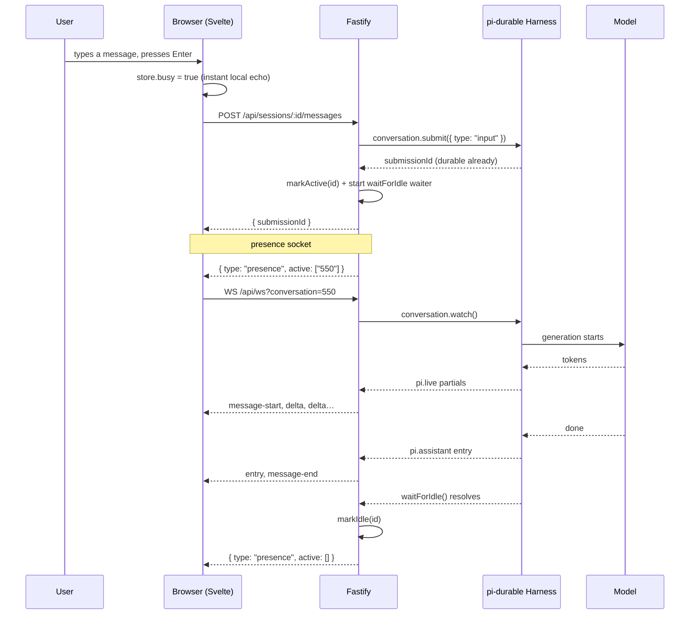
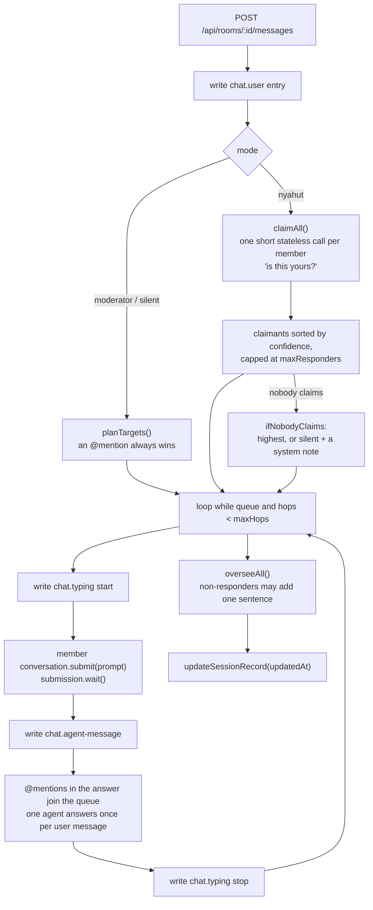

# dura-agents

The application is called **dura-agents**; the repository and its directory keep the name `durable-agents`.

A local, single-user web app for **durable agent chat**: threads that survive restarts, agents defined by
two markdown files, and group chats where several agents talk to each other.

Built on [`@earendil-works/pi-durable`](https://www.npmjs.com/package/@earendil-works/pi-durable) — every
message, tool call and generation is a durable task in SQLite, so closing the browser or killing the server
does not lose work in flight.

```bash
npm install
npm run dev          # server on 8787 + Vite on 5173, one token created in data/token
```

Open <http://localhost:5173>.

---

## Status — where we are right now

**Phases 1–4 complete. Phase 5 partial. Phase 5.5 complete. Phases 6 and 6.0 partial. Phase 10 partial (the
animation half). Phases 7–9 not started.**

| Area | State |
| --- | --- |
| Durable chat + streaming over WebSocket | **Done** — `resume()` replays interrupted work |
| Agents from `AGENT.md` + `SOUL.md` | **Done** — hot-reloaded into existing threads (`rebindAgent`) |
| Group chat with modes (`Nyahut` / `Moderator` / `Silent`) | **Done** |
| 3-phase `Nyahut` (claim → answer → oversee) | **Done** |
| PWA + provider credential screen | **Partial** — installable; no push notifications |
| Per-agent model picker + capability badges | **Done** |
| Agent & group identity (colour + emoji) | **Done** |
| Live "replying" indicator, per session | **Done** |
| Responsive layout + design system | **Done** — 5 viewport tiers in the screenshot gate |
| E2E suite (faux provider, deterministic) | **13 scenarios passing** |
| Image and document attachments | **Done** — bytes live in the entry the model was given |
| Live activity indicator (phase, calls, elapsed) | **Done** — derived from `pi.live`, never a guess |
| Storage: size report, cleanup, purge | **Done** — the `#/usage` panel prints the bytes the cleanup actually gave back |
| The `question` tool + keyless web search | **Done** — a durable `chat.question` with option buttons; DuckDuckGo's HTML endpoint, no key |
| Hyperlinks and mermaid diagrams in an answer | **Done** — external links open away, a diagram fetches its library only when it is there |
| Voice, video | **Not started** |
| MCP servers, per-agent hooks, skills/curator | **Not started** |

Latest verified run:

| Check | Result |
| --- | --- |
| `npm run check` | `tsc` clean · `svelte-check` **0 errors, 2 warnings** (both in `Dialog.svelte`, untouched) · `lint:lang` clean |
| `npm run e2e` | **13 passed, 0 failed** (`activity`, `attachments`, `identity`, `live-activity`, `memory`, `models`, `permissions`, `questions`, `search`, `sessions`, `steering`, `storage`, `tools`) |
| `npm run build` | entry **71.86 kB JS** + **7.70 kB CSS** gzip (budget 100 kB); mermaid and its layout engines stay in their own chunks (`mermaid.core` 29.31 kB, `elk` 455.84 kB gzip), fetched only when a diagram renders |
| `npm run shots:replying` | 11 screenshots |
| `npm run shots` | not re-run in this session — the last full pass (8 routes × 5 viewports) lives in `docs/ui-review/2026-10-17/` |
| `#/usage` Storage panel | 2 screenshots + the rendered DOM checked (6 rows, no wrapping or overflow at 1440×900 and 390×844, the cleanup line read back after a click) — see [`docs/ui-review/`](docs/ui-review/) |

The plan of record, with the evidence for each phase, lives in [`docs/roadmap.md`](docs/roadmap.md).
UI review notes and screenshots live in [`docs/ui-review/`](docs/ui-review/).

---

## Architecture



### Component responsibilities

| Module | Owns |
| --- | --- |
| `packages/server/src/index.ts` | Every REST route, the WebSocket upgrade, the boot-time activity scan |
| `auth.ts` | Rejects any request without `X-PI-Token`, allowlists `Host` |
| `sessions.ts` | The session index (`data/sessions.json`), transcripts, `sendMessage`, `rebindAgent` |
| `rooms.ts` | Group orchestration; `roomOf()` rebuilds `RoomConfig` field by field |
| `router.ts` | `planTargets()` — a **pure** function deciding who answers |
| `nyahut.ts` | The claim and oversee passes (short, stateless calls) |
| `activity.ts` | In-memory registry of sessions that are generating |
| `stream.ts` | Turns `conversation.watch()` into wire frames, reading partials from `pi.live` |
| `agents.ts` | Reads/writes `data/agents/<slug>/{agent.json,AGENT.md,SOUL.md}` |
| `models.ts`, `capabilities.ts` | Provider credentials and the per-model capability catalog |
| `storage.ts` | What the data directory holds, the checkpoint + vacuum, and the purge that exports before it deletes |
| `questions.ts`, `search.ts` | The `question` tool (a durable `chat.question` entry) and the keyless DuckDuckGo `web-search` tool |
| `wire.ts` | The server→web frame contract (mirrored in `packages/web/src/ws.ts`) |
| `packages/web/src/state.svelte.ts` | The single runes store; the only place frames mutate state |
| `packages/web/src/lib/identity.ts` | One normaliser for agent/group/member identity |
| `packages/web/src/lib/markdown.ts` | Markdown → sanitized HTML, mermaid fences, and the external/internal link policy |
| `packages/web/src/views/Usage.svelte` | The usage graphs and the Storage panel |
| `packages/web/src/ws.ts` | Per-conversation socket plus the presence socket |

### Data model



One thread is one conversation. A group **is** a thread whose session record carries a `room`; each member
gets its own conversation under `room.conversations`, created on first use.

A user message is one `chat.user` entry. `entry.model` holds the messages the provider was given — image
blocks included — and `entry.data.files[]` describes them, so an attachment has exactly one home and there
is no second store to keep in step.

---

## How it works right now

### The streaming contract

Streaming is the least obvious part of the system, and it exists in its current shape for a concrete
reason: **`message_update` is never emitted by `watchEvents` for the `opencode-go` provider**, so partials
never arrive as translated view changes. The server therefore reads the assistant message in flight
straight out of the durable `pi.live` document and diffs it:

```ts
// packages/server/src/stream.ts — the core of live streaming
const watch = await conversation.watch(streamContext);
for (const entry of watch.value.entries) seen.add(String(entry.id));
send({ type: "snapshot", entries: entriesToMsgs(watch.value.entries) });

watch.start((view) => publish(view));

function publish(view: ViewLike): void {
  for (const entry of view.entries) {
    const id = String(entry.id);
    if (seen.has(id)) continue;
    seen.add(id);
    const message = entryToMsg(entry);
    if (message) send({ type: "entry", entry: message });
    if (entry.kind === "pi.assistant") send({ type: "message-end", text: message?.text ?? "" });
  }

  const next = liveText(view);              // reads docs["pi.live"].generation.message.content
  if (next.startsWith(partial)) {
    const chunk = next.slice(partial.length);
    if (chunk) {
      if (partial === "") send({ type: "message-start" });
      send({ type: "delta", text: chunk });
    }
    partial = next;
  }
}
```

The wire sequence a client actually sees, captured with `node scripts/ws-probe.mjs <id> "hello"`:

```text
snapshot       { entries: [...] }        # durable transcript so far
entry          { role: "user" }          # the message you just sent
message-start                            # a bubble opens
delta          { text: "Ahoy, " }        # partials, ~80 ms apart
delta          { text: "I am the " }
delta          { text: "pirate captain " }
entry          { role: "assistant" }     # the committed entry
message-end    { text: "Ahoy, I am the pirate captain of this crew." }
```

`watchEvents` also emits start/end events for **user** entries, so only `pi.assistant` entries are allowed
to close the bubble.

### Attachments live in the entry

A message carries its own files: one request, one commit, one entry. The reason it can be that simple is a
property of the durable layer — an input's entry stores the message the provider was given (`appendInput`
builds `model: [userMessage]` for *any* entry kind that does not start with `pi.`), so the bytes the model
saw are already durable. Copying them anywhere else would be the copy.



What that buys, and what it costs:

- **No upload route, no temporary file, no garbage collection.** A file exists exactly where the model read
  it, so a reload and a restart are trivially faithful — there is nothing to lose track of. The retrieval
  route resolves the entry, checks it belongs to *that* conversation, and serves the block.
- **The server normalizes, not the browser.** Images go through the same Photon processor `read` uses, to
  the model's own `inputLimits`. One limit table instead of two, and no canvas code to re-implement EXIF
  orientation. Photon's worker needs a plain `Uint8Array`: a Node `Buffer` makes `prepare()` return
  `undefined`, which would silently omit every uploaded image.
- **Documents become text**, detected by decoding rather than by extension; PDFs go to `pdftotext` on stdin
  and never through a path. An over-long document is truncated with the same numbers shown to the model and
  to the user, and a file that cannot be read keeps its place in the bubble with the reason.
- **A refusal is free.** `prepareUserMessage` validates and converts before `submit`, so a 400 means the
  draft is intact: nothing was written, no model call was spent.
- **Groups refuse attachments** (400, readable reason). Each member conversation is its own model-visible
  entry, so supporting it would keep one copy of every byte per member.
- **The costs accepted:** the same photo attached twice is stored twice, `app.sqlite` grows with the images
  it holds, and the message route declares its own 24 MiB body limit because a message carries its files.

### Storage: report first, then give some back

The data directory is not one file, and "cleanup" means three different things that are worth keeping
apart. `storage.ts` reports the parts a reader would recognise — `app.sqlite`, its `-wal` and `-shm`
siblings, the session index and the agents' own files — and the `#/usage` panel draws them as shares of that
total.

- **A checkpoint** folds the write-ahead log back into the database. The log grows independently of the data
  and is pure overhead once every reader has passed it, so `POST /api/storage/cleanup` runs
  `wal_checkpoint(TRUNCATE)` and then `VACUUM`, on a **second connection** with a short busy timeout instead
  of reaching into the harness's own.
- **A vacuum** rewrites the file without the space deletions left behind.
- **A purge** removes one conversation's rows for good.

The response is the point: cleanup returns `{ before, after, reclaimedBytes }`, and the panel prints the
measured number — including the honest **`0 B reclaimed`** of a second run that had nothing to give back.
The page never claims space it did not get.

A purge is the destructive one, which is why it is not a delete:



Two consequences follow from that shape. The rows are the only copy of the transcript, so the export happens
first and its path comes back with the result. And because the rows are gone, `Restore` could never work — so
the session record is removed outright and the route 404s afterwards, instead of pretending a thread is
hidden when it is empty. `npm run e2e storage` proves the rows left the `entries` table, not just the list.
There is no purge control in the UI yet; the panel states what a purge would do instead of offering one.

### Asking, and searching without a key

Two tools exist because the model has a hole where they belong.

- **`question`** asks the user and ends the turn. It writes a durable `chat.question` entry
  (`{ text, author, options }`) instead of printing the question as model text, so the transcript mapper
  needs no special case: the entry already has `text` and `author`, and `data.options` is what the client
  reads to draw the buttons. The answer is an ordinary user message, which is why the tool writes nothing
  else and tells the model its turn is over. A question is answerable once — a later user message in the
  thread locks its buttons.
- **`web-search`** goes to DuckDuckGo's keyless HTML endpoint over the built-in `fetch`: no MCP server, no
  dependency, no credential, because pi-ai has no provider-native search and this machine has no search key.
  That is a **shape dependency, not an API**, so the tool names the provider in every result and reports a
  changed page (`… returned no recognizable results, so its markup may have changed`) or an HTTP failure as
  a failure. A query with genuinely nothing to show is the only case that answers with no results.

### Links and diagrams in an answer

Markdown comes from a model, so both of these are security-relevant rather than cosmetic.

- **A link is either this app or the web.** `renderMarkdown` installs a DOMPurify hook that gives every
  external anchor `target="_blank"` with `rel="noreferrer noopener"` — after sanitizing, so raw HTML in a
  message goes through the same rule — and strips `target`/`rel` from a same-page `#` link, which belongs to
  the in-app router. `javascript:` never reaches the hook; DOMPurify drops the attribute first.
- **A diagram is a component, not an image.** A fenced ```mermaid block is split out before markdown is
  rendered and handed to `Mermaid.svelte`, which imports `mermaid` **inside** its render effect, so a thread
  with no diagram downloads none of it (`mermaid.core` and `elk` are separate chunks).
  `securityLevel: "strict"` is not optional when the source is a model: it keeps labels as text instead of
  letting them inject HTML or click handlers. Pan, zoom and reset are plain transform math on a wrapper, and
  an unclosed fence stays an ordinary code block until its closing fence arrives, so a diagram still
  streaming in does not flash an error.

### Who is replying

The sidebar and the chat both need to know which sessions are generating, including sessions you are not
looking at. Rather than polling, the server tracks it in memory and pushes it:



`waitForIdle()` is the harness's own signal, so there is no polling and no transcript scanning. The clear
is epoch-guarded, so a waiter that resolves late cannot wipe the mark of a generation that started in
between, and a 10-minute watchdog stops a hung provider from pinning a spinner forever.

### What the indicator is allowed to say

"Replying" is not enough to look at, and a fake progress bar is worse than no indicator. So the phase is
*derived* on the server from `pi.live` and `pi.inbox`, and every row below is a signal that was actually
observed:

| Condition (first match wins) | phase |
| --- | --- |
| `compactions` non-empty | `compacting` |
| `generation.retry` present | `retrying` |
| some call is not `done` | `tool` |
| the partial has a non-empty text block | `writing` |
| the partial has a non-empty thinking block | `thinking` |
| `run` present, no generation yet | `starting` |
| nothing running | `null` — no motion at all |

"Thinking" therefore requires thinking tokens and "writing" requires text: a model that emits neither says
`starting`, which is true, instead of guessing. The phase, the calls, the counts and the queued inputs
arrive as **one `activity` snapshot** (the same snapshot-never-diff rule as presence and the tool trace), so
a phase and a call list that describe one round cannot disagree.

Two honesty rules are worth stating because they removed features rather than adding them:

- **Elapsed time comes from the run task's durable `startedAt`**, read once per run, so a reconnect reports
the real elapsed time instead of restarting the clock at zero — and when it cannot be read, no timer is
shown at all.
- **There is no per-call timer.** With `toolExecution: "parallel"` a call is already `running` on the first
publish that mentions it, so no connection can observe when it began; a stamp taken at first sight would
really mean "since I connected". The row keeps the indeterminate sweep and the round keeps the real elapsed
time.

Motion follows the roadmap's rule: only `opacity` + `transform`, inside fixed-size clipped boxes, at most one
sweep per row (and one round-level sweep past three calls in flight), nothing at all while the tab is
hidden, and fully static under `prefers-reduced-motion` — where the sweep is hidden outright, because a
frozen bar in an arbitrary position reads as progress.

### Group chat: `Nyahut`



Claim and oversee are **short stateless calls** (`models.completeSimple`), while answers are full durable
calls. A user message therefore costs roughly `2N − R` short calls plus `R` full ones, where `N` is the
member count and `R` the number of responders.

---

## Quick start

```bash
npm install
npm run dev
```

The dev command creates a 32-byte token in `data/token` (mode `600`), starts Fastify on `8787` and Vite on
`5173`, and injects the token into the page as `window.__PI_BOOT__`.

Credentials resolve in this order: `~/.pi/agent/auth.json` → `OPENCODE_API_KEY` → `data/credentials.json`.
The `#/providers` screen writes the last one. To run the whole thing as one process:

```bash
npm run build && npm start      # one Fastify process serving UI + API + WS on 8787
```

### Reaching it from a phone

The server listens on loopback only and speaks plain HTTP, so a phone needs TLS and a route in front of it
before the UI can be installed as an app. The runbook — Tailscale, the `PI_ALLOWED_HOSTS` allowlist, the
systemd user unit and the iOS/Android install — is in [`docs/tailscale.md`](docs/tailscale.md).

### Commands

| Command | Purpose |
| --- | --- |
| `npm run dev` | Token + server + Vite in one command |
| `npm run build` | Build the UI into `packages/web/dist` |
| `npm start` | Local production: one process for UI + API + WS |
| `npm run check` | `tsc` (server) + `svelte-check` (web) + `lint:lang` |
| `npm run e2e` | Every E2E scenario against a throwaway server |
| `npm run e2e:real` | Also run the optional real-model scenario |
| `npm run shots` | 8 routes × 5 viewports → `docs/ui-review/<date>/` |
| `npm run shots:replying` | The replying indicator, the attachment cards, each activity phase and the Full Access control, on a throwaway E2E server |
| `npm run smoke` | Harness + storage + one real question to the model |
| `npm run smoke:image` | The same, with an image attachment: proves a real model sees it |
| `npm run seed` | Seed demo threads (no model calls) |
| `npm run lint:lang` | Fail on Indonesian text in system files |

### Routes

| Route | Contents |
| --- | --- |
| `#/` | Empty state + new-thread button |
| `#/s/<id>` | Chat — plain thread, agent thread, or a group with the mode switch |
| `#/groups` | Create a group + the group list |
| `#/usage` | Usage graphs, the Storage panel and the cleanup |
| `#/agents`, `#/agents/new`, `#/agents/<id>` | Agent list + the `AGENT.md`/`SOUL.md` editor |
| `#/providers` | Provider credential status + API key entry |

### API

| Method | Path | Notes |
| --- | --- | --- |
| `GET` | `/api/health` | Liveness |
| `GET` `POST` `PATCH` `DELETE` | `/api/sessions[/:id]` | `?includeDeleted=1` lists soft-deleted threads |
| `POST` | `/api/sessions/:id/{restore,move,restart,abort}` | Restore, move to another agent, fresh context, abort |
| `POST` | `/api/sessions/:id/permissions` | Grant or revoke Full Access for that thread alone |
| `POST` | `/api/sessions/:id/purge` | Exports the transcript to `data/exports/<id>.json`, then deletes its rows and the session record — irreversible |
| `GET` `POST` | `/api/sessions/:id/context` · `/api/sessions/:id/compact` | Context used against the model's window / compact now |
| `PUT` | `/api/sessions/:id/model` | The composer's model switch (on an agent thread it moves the agent) |
| `GET` `POST` | `/api/sessions/:id/messages` | Transcript / send. A message carries its own attachments |
| `GET` | `/api/sessions/:id/attachments/:entryId/:index` | One file of a message, read out of that entry |
| `GET` `POST` | `/api/storage[/cleanup]` | Sizes split by what a reader recognises / checkpoint + vacuum, returning the sizes before and after and `reclaimedBytes` |
| `GET` `POST` `PUT` `DELETE` | `/api/agents[/:id]` | `PUT` returns `rebound`: how many threads took the new files |
| `GET` `PUT` | `/api/providers[/:id/key]` | Credential status and key entry |
| `GET` | `/api/models?provider=` | Capability catalog: image support, context, cost, thinking levels |
| `POST` | `/api/models/test` | One cheap round trip to prove a model works |
| `GET` | `/api/activity` | Which sessions are generating right now |
| `GET` | `/api/usage` | The Usage screen's numbers, read from the durable log |
| `POST` `PUT` | `/api/rooms[/:id]` | Create a group / change its members and mode |
| `GET` `POST` | `/api/e2e/{state,script}` | The faux-provider script, only when `PI_E2E=1` and the token is right |
| `GET` | `/api/ws?conversation=<id>` | That conversation's stream |
| `GET` | `/api/ws/presence` | Activity for every session |

### Debug tools

| Command | Purpose |
| --- | --- |
| `node scripts/ws-probe.mjs <id> "message"` | Attach to a stream, post, print arriving frames |
| `node packages/server/scripts/events-probe.ts <id> "message"` | Print raw pi-durable events |
| `node packages/server/scripts/live-probe.ts <id>` | Watch the `pi.live` document during generation |
| `node packages/server/scripts/stream-probe.ts` | Provider streaming, bypassing the harness |
| `node packages/server/scripts/settle-probe.ts <id>` | Shape of the `submission.wait()` record |
| `node packages/server/scripts/nyahut-probe.ts` | Exercise the claim and oversee passes |

---

## Project layout

```text
packages/server/src/     Fastify + pi-durable: harness, models, sessions, rooms, stream, activity, auth
packages/web/src/        Svelte 5 + Vite: views, components, state, ws, identity
packages/web/scripts/    shots.mjs, shots-replying.mjs (Chromium screenshot harness)
scripts/dev.mjs          One dev command (token + server + Vite)
scripts/e2e/             Deterministic E2E: harness.mjs, run.mjs, scenarios/
apps/desktop/            Tauri shell — never compiled; see Known gaps
data/                    gitignored: app.sqlite, sessions.json, token, credentials.json, agents/
docs/                    roadmap.md, tailscale.md (phone access), ui-review/ (screenshots + findings)
deploy/                  dura-agents.service (systemd user unit)
```

## Design system

The UI follows an **Ethereal Glass** language: a near-black OLED base (`#08090b`), one faint radial mesh
capped at 6% so it can never wash out text, and hairline rings (`rgb(255 255 255 / 7%)`) instead of solid
grey borders.

- **Type** — Geist Variable for UI, Geist Mono for code, self-hosted via `@fontsource-variable`.
- **Radii** — a 20 / 14 / 10 px scale (`--r-lg` / `--r-md` / `--r-sm`), never a hardcoded value.
- **Depth** — the "double bezel": an outer shell plus an inner core with a top highlight, used on the hero
  surfaces (empty state, identity card) and read on cards and panels.
- **Motion** — one curve, `cubic-bezier(0.32, 0.72, 0, 1)`, at 180 / 320 / 700 ms. Only `opacity` and
  `transform` are ever animated, and `prefers-reduced-motion` leaves everything statically legible.
- **Identity** — every agent and group has a colour and an emoji face, normalised in one place
  (`lib/identity.ts`) so the sidebar, chat header and bubbles can never disagree.

The layout is a fixed-height shell: only inner panes scroll (`grid-template-rows: minmax(0, 1fr)`), so the
composer is always visible. Below 1024 px the sidebar narrows, below 720 px it becomes an off-canvas drawer.

## Testing

**E2E only — there are no unit tests.** Every scenario boots its own throwaway server (own port, own data
directory, own token) with `PI_E2E=1`, which swaps every real provider for the official **faux provider**.
That makes the whole stack deterministic: no network, no cost, no flakes.

| Scenario | Asserts |
| --- | --- |
| `sessions` | Create → stream deltas → rename → delete → restore → move → restart persistence |
| `identity` | An agent's and a group's colour + emoji are stored, survive a restart, and — the point — survive a later patch that touches an unrelated field |
| `models` | The capability catalog is served over HTTP; the model set per agent is the model that answers; switching it switches the answer |
| `storage` | The report adds up; a purge exports the transcript first, deletes the rows (asserted against the `entries` table, not the list), leaves the thread list and 404s afterwards; cleanup reports its before/after sizes and a second run is harmless |
| `attachments` | The model's own view of the bytes, the entry's own bytes after a restart, the 400 when the model cannot see images, the per-message budgets |
| `live-activity` | The phase ladder (`starting`, `queued`, `tool`, `writing`), the counts and the run's durable elapsed time, including across a reconnect |
| `questions` | The `question` tool writes a `chat.question` entry with its options and ends the turn; the answer arrives as the next user message |
| `search` | The DuckDuckGo parser (`uddg` redirects, entities, `<b>` highlighting) and the paths that must not look like "no results": 429, unreadable markup, unreachable provider. `fetch` is stubbed, so no network is involved |
| `permissions` | The per-thread Full Access grant: stored on the thread, enforced at submit time, and not sticky on the agent |
| `activity` | An idle thread is not active; a thread is active while streaming and clears after; abort clears immediately; a group stays active across the whole flow; an idle thread is still not active **after a restart** |

Two E2E findings worth keeping in mind, because both were real bugs the suite caught immediately:

1. **An instant faux answer never streams.** With the default speed the answer completed before the first
   partial commit, so no `delta` frames appeared. The faux provider now streams at `tokensPerSecond: 12`.
2. **A harness that announces `content-type: application/json` on an empty body gets a 400 from Fastify.**
   `DELETE` looked broken until the harness only claimed a JSON body when it had one.

The screenshot gate is part of testing: `npm run shots` captures 8 routes at 1440/1280/1024/768/390 and
writes `manifest.json` plus `findings.md`. The 768 and 390 tiers exist because without them a broken mobile
drawer looks exactly like a working one.

## Security

The server binds `127.0.0.1`, rejects any request without the `X-PI-Token` header (or `?token=` on the
WebSocket handshake) with **401**, and allowlists `Host` to `127.0.0.1|localhost`. There is no permissive
CORS, so a foreign web page can neither read the app nor reach an API that runs commands. The token is a
random 32 bytes, stored mode `600`, and injected into the page by the server or Vite.

Agents with the `bash` tool run **real commands on this machine** — that is the point of the tool, and the
editor warns about it.

## Language policy

All system text is English: code, comments, UI labels, API messages, model prompts, templates and docs.
Indonesian is allowed only in `data/` (your own threads, conversations, agent `SOUL.md`/`AGENT.md`) and in
the maintainer's briefs. `npm run lint:lang` enforces this; a `lang-allow` comment exempts a line that must
contain Indonesian, such as a keyword list.

---

## What's next

In the order I would do them:

1. **Phase 9 — voice and video.** Video: the browser extracts 6 evenly spaced frames plus a duration
   caption. Voice: STT with feature detection (the mic button appears only when supported, and says why when
   it is not) and TTS through `speechSynthesis`, with a per-agent `autoRead`.
2. **Phase 7 — MCP servers and hooks per agent.**
3. **Phase 8 — many skills per agent plus a curator**, which proposes reusable skills after a run and
   promotes them on acceptance.
4. **Phase 10 leftovers** — skeleton loaders, `:focus-visible` rings, `text-wrap: balance`,
   `tabular-nums`, ≥44 px tap targets.
5. **Phase 6.0 leftovers** — the browser-level UI E2E (`ui.test.mjs`; `puppeteer-core` is not installed) and
   the agent editor's `vision` toggle.

Phase 10's animation work is delivered (the phase indicator, the tool-call motion and the responsive gate);
the remaining items are polish.

## Known gaps

These are **not** done — please do not read the status table as claiming otherwise.

- **A purge has no UI.** `POST /api/sessions/:id/purge` is the only way to remove a thread's rows for good.
  The thread menu's delete stays a soft delete, and the Storage panel explains the difference rather than
  offering the button.
- **A diagram is a large lazy download.** mermaid and its layout engines are their own chunks, fetched on the
  first diagram a thread renders — `elk` alone is ≈456 kB gzip. The entry bundle is untouched, but the first
  diagram is not cheap.
- **Web search follows DuckDuckGo's HTML.** Keyless and dependency-free, but the markup is a shape
  dependency: when it changes the tool reports a failure rather than an empty result list, and the `search`
  E2E asserts against a stubbed page instead of the live endpoint.
- **`#/usage` is not in the screenshot gate.** `npm run shots` photographs 8 routes; the Storage panel was
  reviewed with a throwaway DevTools-protocol script (see `docs/ui-review/<date>/`), not by the committed
  harness.
- **Attachments cannot be sent in a group thread.** Refused with a readable reason: each member
  conversation is its own model-visible entry, so supporting it would keep one copy of every byte per
  member.
- **There is no per-call elapsed time.** With parallel tool execution a call is already running on its
  first publish, so its start is not observable; the round's own elapsed time is real and is shown instead.
- **The Tauri shell has never been compiled.** `tauri-plugin-single-instance` is not installed, so do not
  run the desktop app twice — that would start two servers over one `app.sqlite`.
- **System notifications on turn completion are not wired up.** The PWA is installable.
- **No real cost counter.** `Nyahut` shows an estimated tooltip only; a group message costs about
  `2N − R` short calls plus `R` full ones.
- **Tap targets are 40 px on coarse pointers, not the 44 px Apple figure.**
- **The double bezel on cards and panels is a single-element read** (outer ring + hairline + inner
  highlight) rather than true nesting. Real nesting is used on the hero surfaces where the depth shows.
- **No multi-user, remote deployment, billing, mobile app or marketplace.** This is a local, single-user
  tool by design.
- The `pi-lens` checker can report **stale** findings for web files. When it contradicts `grep`,
  `npx tsc -p packages/web/tsconfig.json --noEmit`, `svelte-check` and `npm run build`, trust those four.
  If it insists, delete `~/.pi-lens/projects/*/cache/project-snapshot.json.gz` and re-scan.

## License

[MIT](LICENSE)
