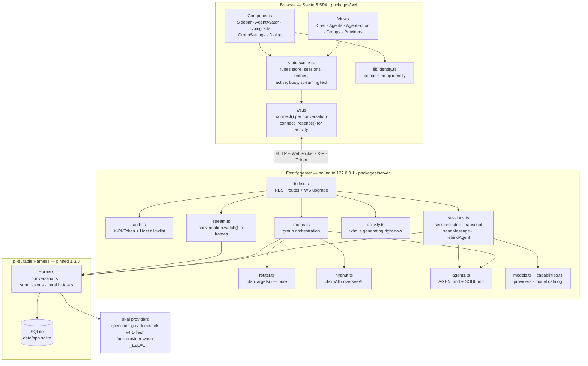
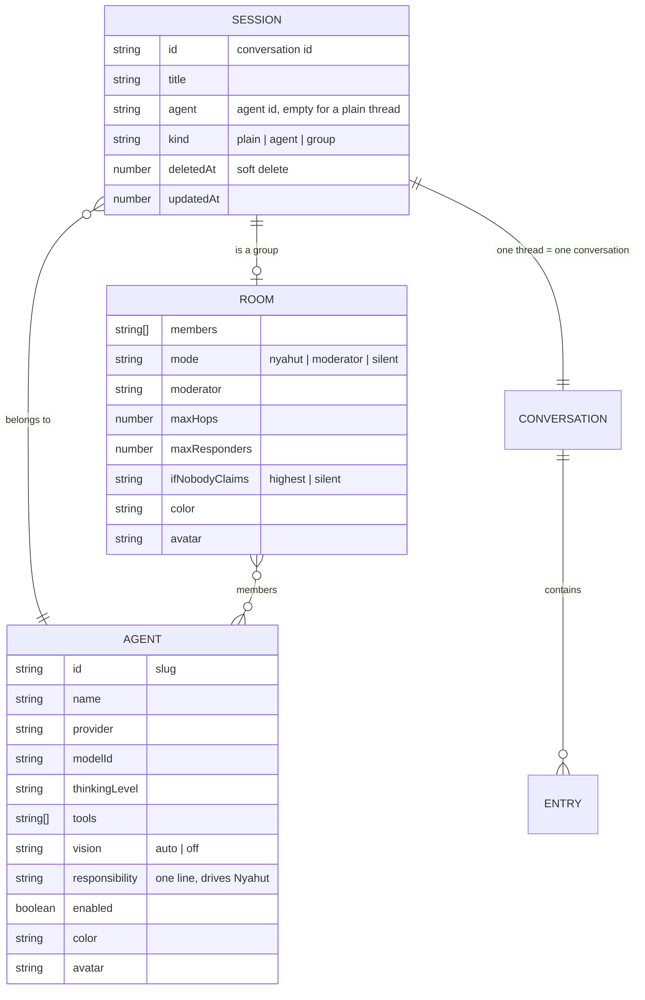
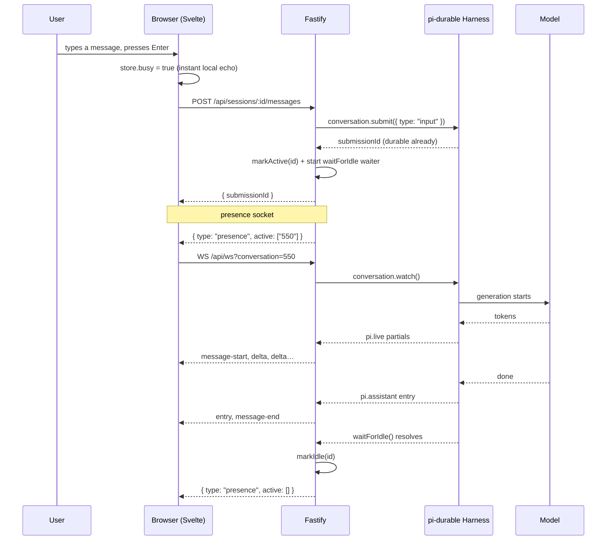
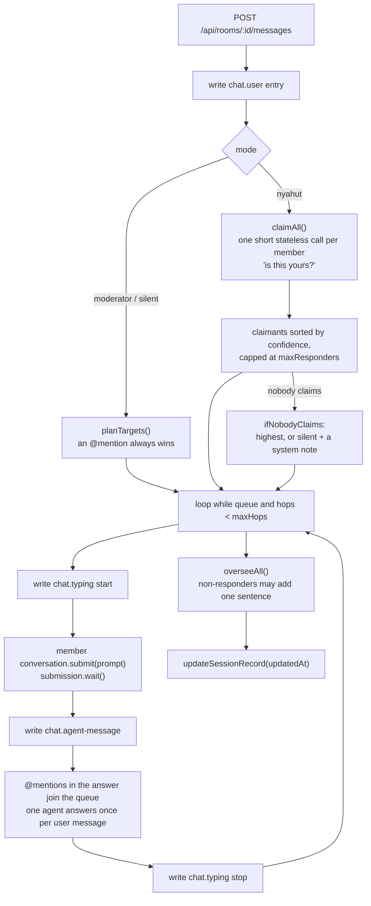

# dura-agents

The application is called **dura-agents**; the repository and its directory keep the name `durable-agents`.

A local, single-user web app for **durable agent chat**: threads that survive restarts, agents defined by
two markdown files, and group chats where several agents talk to each other.

Built on [`@earendil-works/pi-durable`](https://www.npmjs.com/package/@earendil-works/pi-durable) — every
message, tool call and generation is a durable task in SQLite, so closing the browser or killing the server
does not lose work in flight.

```bash
npm install
npm run dev          # server on 8787 + Vite on 5173, one token created in data/token
```

Open <http://localhost:5173>.

---

## Status — where we are right now

**Phases 1–4 complete. Phase 5 partial. Phase 5.5 complete. Phases 6 and 6.0 partial. Phases 7–10 not
started.**

| Area | State |
| --- | --- |
| Durable chat + streaming over WebSocket | **Done** — `resume()` replays interrupted work |
| Agents from `AGENT.md` + `SOUL.md` | **Done** — hot-reloaded into existing threads (`rebindAgent`) |
| Group chat with modes (`Nyahut` / `Moderator` / `Silent`) | **Done** |
| 3-phase `Nyahut` (claim → answer → oversee) | **Done** |
| PWA + provider credential screen | **Partial** — installable; no push notifications |
| Per-agent model picker + capability badges | **Done** |
| Agent & group identity (colour + emoji) | **Done** |
| Live "replying" indicator, per session | **Done** |
| Responsive layout + design system | **Done** — 5 viewport tiers in the screenshot gate |
| E2E suite (faux provider, deterministic) | **4 scenarios passing** |
| Image/file attachments, voice, video | **Not started** |
| MCP servers, per-agent hooks, skills/curator | **Not started** |

Latest verified run:

| Check | Result |
| --- | --- |
| `npm run check` | `tsc` clean · `svelte-check` **0 errors** · `lint:lang` clean |
| `npm run e2e` | **7 passed, 0 failed** (`activity`, `identity`, `memory`, `models`, `sessions`, `steering`, `tools`) |
| `npm run build` | **62.3 kB JS** + **6.7 kB CSS** gzip (budget 100 kB) |
| `npm run shots` | 40 screenshots across 5 viewports |
| `npm run shots:replying` | 3 screenshots of the replying indicator |

The plan of record, with the evidence for each phase, lives in [`docs/roadmap.md`](docs/roadmap.md).
UI review notes and screenshots live in [`docs/ui-review/`](docs/ui-review/).

---

## Architecture



### Component responsibilities

| Module | Owns |
| --- | --- |
| `packages/server/src/index.ts` | Every REST route, the WebSocket upgrade, the boot-time activity scan |
| `auth.ts` | Rejects any request without `X-PI-Token`, allowlists `Host` |
| `sessions.ts` | The session index (`data/sessions.json`), transcripts, `sendMessage`, `rebindAgent` |
| `rooms.ts` | Group orchestration; `roomOf()` rebuilds `RoomConfig` field by field |
| `router.ts` | `planTargets()` — a **pure** function deciding who answers |
| `nyahut.ts` | The claim and oversee passes (short, stateless calls) |
| `activity.ts` | In-memory registry of sessions that are generating |
| `stream.ts` | Turns `conversation.watch()` into wire frames, reading partials from `pi.live` |
| `agents.ts` | Reads/writes `data/agents/<slug>/{agent.json,AGENT.md,SOUL.md}` |
| `models.ts`, `capabilities.ts` | Provider credentials and the per-model capability catalog |
| `wire.ts` | The server→web frame contract (mirrored in `packages/web/src/ws.ts`) |
| `packages/web/src/state.svelte.ts` | The single runes store; the only place frames mutate state |
| `packages/web/src/lib/identity.ts` | One normaliser for agent/group/member identity |
| `packages/web/src/ws.ts` | Per-conversation socket plus the presence socket |

### Data model



One thread is one conversation. A group **is** a thread whose session record carries a `room`; each member
gets its own conversation under `room.conversations`, created on first use.

---

## How it works right now

### The streaming contract

Streaming is the least obvious part of the system, and it exists in its current shape for a concrete
reason: **`message_update` is never emitted by `watchEvents` for the `opencode-go` provider**, so partials
never arrive as translated view changes. The server therefore reads the assistant message in flight
straight out of the durable `pi.live` document and diffs it:

```ts
// packages/server/src/stream.ts — the core of live streaming
const watch = await conversation.watch(streamContext);
for (const entry of watch.value.entries) seen.add(String(entry.id));
send({ type: "snapshot", entries: entriesToMsgs(watch.value.entries) });

watch.start((view) => publish(view));

function publish(view: ViewLike): void {
  for (const entry of view.entries) {
    const id = String(entry.id);
    if (seen.has(id)) continue;
    seen.add(id);
    const message = entryToMsg(entry);
    if (message) send({ type: "entry", entry: message });
    if (entry.kind === "pi.assistant") send({ type: "message-end", text: message?.text ?? "" });
  }

  const next = liveText(view);              // reads docs["pi.live"].generation.message.content
  if (next.startsWith(partial)) {
    const chunk = next.slice(partial.length);
    if (chunk) {
      if (partial === "") send({ type: "message-start" });
      send({ type: "delta", text: chunk });
    }
    partial = next;
  }
}
```

The wire sequence a client actually sees, captured with `node scripts/ws-probe.mjs <id> "hello"`:

```text
snapshot       { entries: [...] }        # durable transcript so far
entry          { role: "user" }          # the message you just sent
message-start                            # a bubble opens
delta          { text: "Ahoy, " }        # partials, ~80 ms apart
delta          { text: "I am the " }
delta          { text: "pirate captain " }
entry          { role: "assistant" }     # the committed entry
message-end    { text: "Ahoy, I am the pirate captain of this crew." }
```

`watchEvents` also emits start/end events for **user** entries, so only `pi.assistant` entries are allowed
to close the bubble.

### Who is replying

The sidebar and the chat both need to know which sessions are generating, including sessions you are not
looking at. Rather than polling, the server tracks it in memory and pushes it:



`waitForIdle()` is the harness's own signal, so there is no polling and no transcript scanning. The clear
is epoch-guarded, so a waiter that resolves late cannot wipe the mark of a generation that started in
between, and a 10-minute watchdog stops a hung provider from pinning a spinner forever.

### Group chat: `Nyahut`



Claim and oversee are **short stateless calls** (`models.completeSimple`), while answers are full durable
calls. A user message therefore costs roughly `2N − R` short calls plus `R` full ones, where `N` is the
member count and `R` the number of responders.

---

## Quick start

```bash
npm install
npm run dev
```

The dev command creates a 32-byte token in `data/token` (mode `600`), starts Fastify on `8787` and Vite on
`5173`, and injects the token into the page as `window.__PI_BOOT__`.

Credentials resolve in this order: `~/.pi/agent/auth.json` → `OPENCODE_API_KEY` → `data/credentials.json`.
The `#/providers` screen writes the last one. To run the whole thing as one process:

```bash
npm run build && npm start      # one Fastify process serving UI + API + WS on 8787
```

### Reaching it from a phone

The server listens on loopback only and speaks plain HTTP, so a phone needs TLS and a route in front of it
before the UI can be installed as an app. The runbook — Tailscale, the `PI_ALLOWED_HOSTS` allowlist, the
systemd user unit and the iOS/Android install — is in [`docs/tailscale.md`](docs/tailscale.md).

### Commands

| Command | Purpose |
| --- | --- |
| `npm run dev` | Token + server + Vite in one command |
| `npm run build` | Build the UI into `packages/web/dist` |
| `npm start` | Local production: one process for UI + API + WS |
| `npm run check` | `tsc` (server) + `svelte-check` (web) + `lint:lang` |
| `npm run e2e` | Every E2E scenario against a throwaway server |
| `npm run e2e:real` | Also run the optional real-model scenario |
| `npm run shots` | 8 routes × 5 viewports → `docs/ui-review/<date>/` |
| `npm run shots:replying` | The replying indicator, on a throwaway E2E server |
| `npm run smoke` | Harness + storage + one real question to the model |
| `npm run seed` | Seed demo threads (no model calls) |
| `npm run lint:lang` | Fail on Indonesian text in system files |

### Routes

| Route | Contents |
| --- | --- |
| `#/` | Empty state + new-thread button |
| `#/s/<id>` | Chat — plain thread, agent thread, or a group with the mode switch |
| `#/groups` | Create a group + the group list |
| `#/agents`, `#/agents/new`, `#/agents/<id>` | Agent list + the `AGENT.md`/`SOUL.md` editor |
| `#/providers` | Provider credential status + API key entry |

### API

| Method | Path | Notes |
| --- | --- | --- |
| `GET` | `/api/health` | Liveness |
| `GET` `POST` `PATCH` `DELETE` | `/api/sessions[/:id]` | `?includeDeleted=1` lists soft-deleted threads |
| `POST` | `/api/sessions/:id/{restore,move,restart,abort}` | Restore, move to another agent, fresh context, abort |
| `GET` `POST` | `/api/sessions/:id/messages` | Transcript / send. A group post runs the whole flow |
| `GET` `POST` `PUT` `DELETE` | `/api/agents[/:id]` | `PUT` returns `rebound`: how many threads took the new files |
| `GET` `PUT` | `/api/providers[/:id/key]` | Credential status and key entry |
| `GET` | `/api/models?provider=` | Capability catalog: image support, context, cost, thinking levels |
| `POST` | `/api/models/test` | One cheap round trip to prove a model works |
| `GET` | `/api/activity` | Which sessions are generating right now |
| `GET` | `/api/ws?conversation=<id>` | That conversation's stream |
| `GET` | `/api/ws/presence` | Activity for every session |

### Debug tools

| Command | Purpose |
| --- | --- |
| `node scripts/ws-probe.mjs <id> "message"` | Attach to a stream, post, print arriving frames |
| `node packages/server/scripts/events-probe.ts <id> "message"` | Print raw pi-durable events |
| `node packages/server/scripts/live-probe.ts <id>` | Watch the `pi.live` document during generation |
| `node packages/server/scripts/stream-probe.ts` | Provider streaming, bypassing the harness |
| `node packages/server/scripts/settle-probe.ts <id>` | Shape of the `submission.wait()` record |
| `node packages/server/scripts/nyahut-probe.ts` | Exercise the claim and oversee passes |

---

## Project layout

```text
packages/server/src/     Fastify + pi-durable: harness, models, sessions, rooms, stream, activity, auth
packages/web/src/        Svelte 5 + Vite: views, components, state, ws, identity
packages/web/scripts/    shots.mjs, shots-replying.mjs (Chromium screenshot harness)
scripts/dev.mjs          One dev command (token + server + Vite)
scripts/e2e/             Deterministic E2E: harness.mjs, run.mjs, scenarios/
apps/desktop/            Tauri shell — never compiled; see Known gaps
data/                    gitignored: app.sqlite, sessions.json, token, credentials.json, agents/
docs/                    roadmap.md, tailscale.md (phone access), ui-review/ (screenshots + findings)
deploy/                  dura-agents.service (systemd user unit)
```

## Design system

The UI follows an **Ethereal Glass** language: a near-black OLED base (`#08090b`), one faint radial mesh
capped at 6% so it can never wash out text, and hairline rings (`rgb(255 255 255 / 7%)`) instead of solid
grey borders.

- **Type** — Geist Variable for UI, Geist Mono for code, self-hosted via `@fontsource-variable`.
- **Radii** — a 20 / 14 / 10 px scale (`--r-lg` / `--r-md` / `--r-sm`), never a hardcoded value.
- **Depth** — the "double bezel": an outer shell plus an inner core with a top highlight, used on the hero
  surfaces (empty state, identity card) and read on cards and panels.
- **Motion** — one curve, `cubic-bezier(0.32, 0.72, 0, 1)`, at 180 / 320 / 700 ms. Only `opacity` and
  `transform` are ever animated, and `prefers-reduced-motion` leaves everything statically legible.
- **Identity** — every agent and group has a colour and an emoji face, normalised in one place
  (`lib/identity.ts`) so the sidebar, chat header and bubbles can never disagree.

The layout is a fixed-height shell: only inner panes scroll (`grid-template-rows: minmax(0, 1fr)`), so the
composer is always visible. Below 1024 px the sidebar narrows, below 720 px it becomes an off-canvas drawer.

## Testing

**E2E only — there are no unit tests.** Every scenario boots its own throwaway server (own port, own data
directory, own token) with `PI_E2E=1`, which swaps every real provider for the official **faux provider**.
That makes the whole stack deterministic: no network, no cost, no flakes.

| Scenario | Asserts |
| --- | --- |
| `sessions` | Create → stream deltas → rename → delete → restore → move → restart persistence |
| `identity` | An agent's and a group's colour + emoji are stored, survive a restart, and — the point — survive a later patch that touches an unrelated field |
| `models` | The capability catalog is served over HTTP; the model set per agent is the model that answers; switching it switches the answer |
| `activity` | An idle thread is not active; a thread is active while streaming and clears after; abort clears immediately; a group stays active across the whole flow; an idle thread is still not active **after a restart** |

Two E2E findings worth keeping in mind, because both were real bugs the suite caught immediately:

1. **An instant faux answer never streams.** With the default speed the answer completed before the first
   partial commit, so no `delta` frames appeared. The faux provider now streams at `tokensPerSecond: 12`.
2. **A harness that announces `content-type: application/json` on an empty body gets a 400 from Fastify.**
   `DELETE` looked broken until the harness only claimed a JSON body when it had one.

The screenshot gate is part of testing: `npm run shots` captures 8 routes at 1440/1280/1024/768/390 and
writes `manifest.json` plus `findings.md`. The 768 and 390 tiers exist because without them a broken mobile
drawer looks exactly like a working one.

## Security

The server binds `127.0.0.1`, rejects any request without the `X-PI-Token` header (or `?token=` on the
WebSocket handshake) with **401**, and allowlists `Host` to `127.0.0.1|localhost`. There is no permissive
CORS, so a foreign web page can neither read the app nor reach an API that runs commands. The token is a
random 32 bytes, stored mode `600`, and injected into the page by the server or Vite.

Agents with the `bash` tool run **real commands on this machine** — that is the point of the tool, and the
editor warns about it.

## Language policy

All system text is English: code, comments, UI labels, API messages, model prompts, templates and docs.
Indonesian is allowed only in `data/` (your own threads, conversations, agent `SOUL.md`/`AGENT.md`) and in
the maintainer's briefs. `npm run lint:lang` enforces this; a `lang-allow` comment exempts a line that must
contain Indonesian, such as a keyword list.

---

## What's next

In the order I would do them:

1. **Finish phase 6 — attachments.** Image input via `createNodePhotonImages`, a pre-flight that refuses
   images when the model cannot see them, and file attachments in the composer.
2. **Phase 9 — voice and video.** Video: the browser extracts 6 evenly spaced frames plus a duration
   caption. Voice: STT with feature detection (the mic button appears only when supported, and says why when
   it is not) and TTS through `speechSynthesis`, with a per-agent `autoRead`.
3. **Phase 7 — MCP servers and hooks per agent.**
4. **Phase 8 — many skills per agent plus a curator**, which proposes reusable skills after a run and
   promotes them on acceptance.
5. **Phase 10 leftovers** — skeleton loaders, `:focus-visible` rings, `text-wrap: balance`,
   `tabular-nums`, ≥44 px tap targets.
6. **Phase 6.0 leftovers** — transcript purge, and a browser-level UI E2E.

Phase 10's animation and responsive work is already partly delivered (the replying indicator and the
five-tier responsive gate); the remaining items are polish.

## Known gaps

These are **not** done — please do not read the status table as claiming otherwise.

- **Image/file attachments do not exist.** No `createNodePhotonImages` wiring in the composer yet.
- **The Tauri shell has never been compiled.** `tauri-plugin-single-instance` is not installed, so do not
  run the desktop app twice — that would start two servers over one `app.sqlite`.
- **System notifications on turn completion are not wired up.** The PWA is installable.
- **No real cost counter.** `Nyahut` shows an estimated tooltip only; a group message costs about
  `2N − R` short calls plus `R` full ones.
- **Tap targets are 40 px on coarse pointers, not the 44 px Apple figure.**
- **The double bezel on cards and panels is a single-element read** (outer ring + hairline + inner
  highlight) rather than true nesting. Real nesting is used on the hero surfaces where the depth shows.
- **No multi-user, remote deployment, billing, mobile app or marketplace.** This is a local, single-user
  tool by design.
- The `pi-lens` checker can report **stale** findings for web files. When it contradicts `grep`,
  `npx tsc -p packages/web/tsconfig.json --noEmit`, `svelte-check` and `npm run build`, trust those four.
  If it insists, delete `~/.pi-lens/projects/*/cache/project-snapshot.json.gz` and re-scan.

## License

[MIT](LICENSE)
